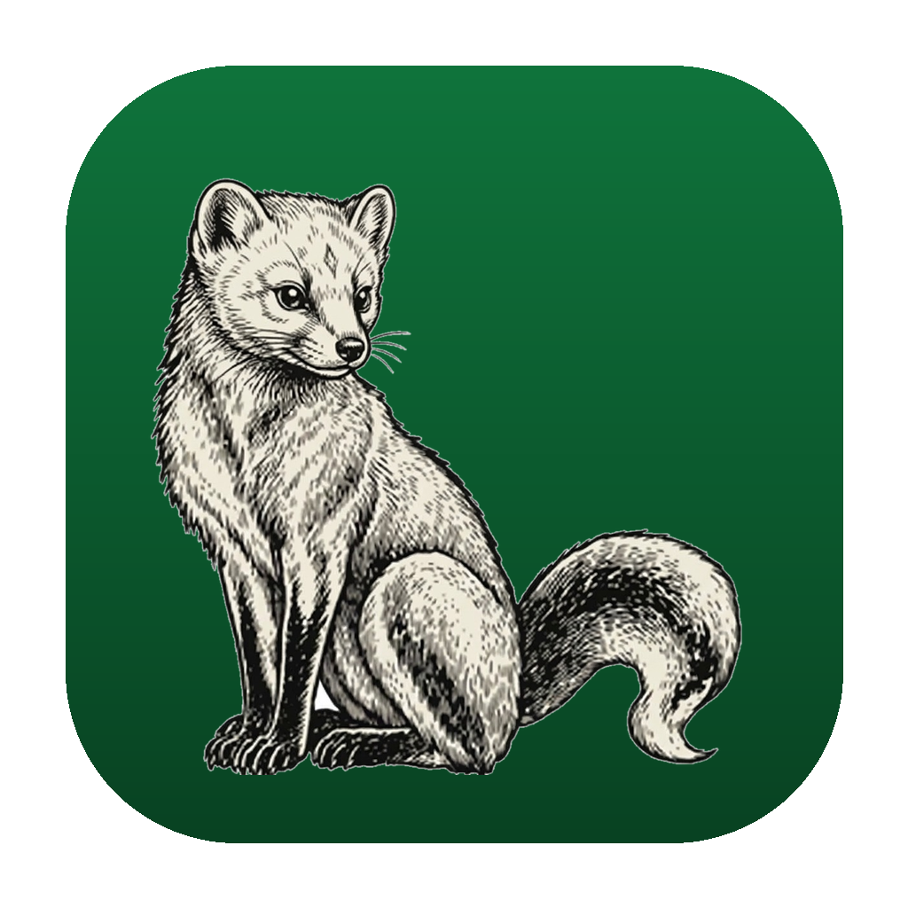

<p align="center">
  
</p>

<h1 align="center">Sable</h1>

<p align="center">
  <strong>Fast, private, and safe macOS disk cleaner & system monitor written in Rust.</strong><br>
  Scans storage footprint, clears stale caches & logs, sweeps application leftovers, and puts everything in the Trash for safe recovery.
</p>

<p align="center">
  <a href="https://github.com/h3ma209/Sable/releases/latest"></a>
  <a href="LICENSE"></a>
  <a href="https://h3ma209.github.io/Sable/"></a>
  
</p>

---

## ⚡ Quick Install (One-Liner)

Install and automatically grant macOS permissions with a single terminal command:

```bash
curl -sSL https://raw.githubusercontent.com/h3ma209/Sable/master/install.sh | bash
```

> **What this does:**
> 1. Detects Apple Silicon (`arm64`) vs. Intel (`x64`).
> 2. Downloads and extracts the latest release into `/Applications/Sable.app`.
> 3. Runs `xattr -cr /Applications/Sable.app` to clear the quarantine flag so Gatekeeper allows it immediately.
> 4. Launches the app.

---

## 💾 Manual Install

1. Download the disk image from the [Latest Release](https://github.com/h3ma209/Sable/releases/latest):
   - **Apple Silicon (M1/M2/M3/M4):** `Sable-*-macos-arm64.dmg`
   - **Intel:** `Sable-*-macos-x64.dmg`
2. Open the `.dmg` and drag **Sable** to **Applications**.
3. If macOS displays an *unidentified developer* notice on first launch:
   ```bash
   xattr -cr /Applications/Sable.app
   ```
   *Or Control-click Sable in `/Applications` and choose **Open**.*

---

## 🌟 Features

| Module | Description |
|---|---|
| **Overview** | Instant health check of cache sizes, downloads, and system load. |
| **Free Up Space** | Reclaims user caches, Xcode DerivedData, logs, with 1-click **Clean All**. |
| **Space Lens** | Fast disk tree hierarchy with real-time search, clickable breadcrumbs, category tags, and Finder buttons. |
| **Apps & Leftovers** | Scans `/Applications` and detects residual files in `Application Support`, `Group Containers`, and `WebKit`. |
| **Tune-Up** | Inspects user `LaunchAgents`, flushes DNS cache, and controls Spotlight indexing. |
| **Big Downloads** | Finds large downloads (50MB+) with search filters and Trash confirmation. |
| **Threat Scan** | Hash comparison against known malicious binaries in Downloads. |
| **System Monitor** | Live CPU and RAM telemetry auto-refreshing every 2 seconds. |

> [!NOTE]
> **Safety First:** Nothing is permanently deleted without your explicit confirmation. All file removals use the native macOS Trash so items can be restored anytime.

---

## ⌨️ Keyboard Shortcuts

- `Cmd+1` → Home / Overview
- `Cmd+2` → Free Up Space
- `Cmd+3` → Installed Apps & Leftovers
- `Cmd+4` → Tune-Up
- `Cmd+5` → File Finder
- `Cmd+6` → Threat Scan
- `Cmd+7` → Big Downloads
- `Cmd+8` → Space Lens
- `Cmd+9` → Cloud Storage
- `Cmd+0` → System Monitor
- `Escape` → Close any open confirmation modal

---

## 🛠️ Build From Source

Requires **Rust 1.80+** and macOS:

```bash
git clone https://github.com/h3ma209/Sable.git
cd Sable/RustUtilityApp

# Build & test
cargo test

# Package macOS App & DMG
make package
open dist/Sable-*.dmg
```

---

## 📄 License

MIT License. See [LICENSE](LICENSE) for details.
