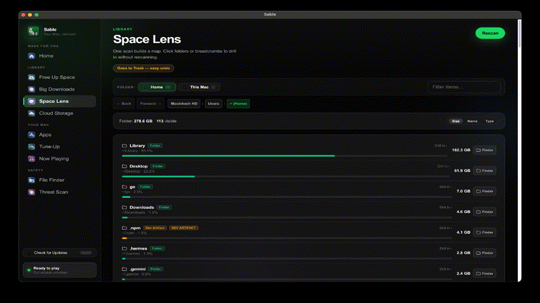

<p align="center">
  
</p>

<h1 align="center">Sable</h1>

<p align="center">
  <strong>The free, open-source, subscription-free CleanMyMac alternative.</strong><br>
  Disk cleanup, space analysis, and system monitoring for macOS — MIT licensed, no analytics, deletes via Trash.
</p>

<p align="center">
  <a href="https://github.com/h3ma209/Sable/releases/latest"></a>
  <a href="https://github.com/h3ma209/Sable/releases"></a>
  <a href="LICENSE"></a>
  <a href="https://h3ma209.github.io/Sable/"></a>
  
</p>

<p align="center">
  
</p>

---

## Install

Pick the path that matches your threat model.

### 1. Build from source (highest trust)

Requires **Rust 1.80+** on macOS:

```bash
git clone https://github.com/h3ma209/Sable.git
cd Sable/RustUtilityApp
cargo test
make package
open dist/Sable-*.dmg
```

You compile the same code that ships in releases — no pre-built binary required.

### 2. Homebrew (power users)

Publish the cask from [`packaging/homebrew/Casks/sable.rb`](packaging/homebrew/Casks/sable.rb) in a `homebrew-sable` tap, then:

```bash
brew tap h3ma209/sable
brew install --cask sable
```

Update `version` and `sha256` in the cask after each release using `SHA256SUMS.txt`.

### 3. Verified binary (GitHub Releases)

1. Download the `.dmg` or `.zip` from [Latest Release](https://github.com/h3ma209/Sable/releases/latest) for your Mac (**arm64** or **x64**).
2. Download **`SHA256SUMS.txt`** from the same release.
3. Verify:

```bash
cd ~/Downloads
shasum -a 256 --check SHA256SUMS.txt
```

4. Open the `.dmg`, drag **Sable** to **Applications**.
5. First launch: **Control-click → Open** (releases are not Apple-notarized yet).

### 4. Convenience script (review before running)

```bash
curl -fsSL https://raw.githubusercontent.com/h3ma209/Sable/master/install.sh -o install-sable.sh
less install-sable.sh
SABLE_VERIFY=1 bash install-sable.sh
```

| Variable | Default | Meaning |
| --- | --- | --- |
| `SABLE_VERIFY=1` | off | Require matching `SHA256SUMS.txt` on the release |
| `SABLE_CLEAR_QUARANTINE=1` | off | **Advanced:** run `xattr -cr` to strip Gatekeeper quarantine |

**Bypass Apple Gatekeeper quarantine (advanced users only):** only set `SABLE_CLEAR_QUARANTINE=1` if you already verified the artifact and accept removing the download quarantine flag.

---

## Transparency — what Sable touches

Routine cleanup is **user-space** only. The engine enumerates fixed roots (see `cleanup.rs`); batch trash refuses anything outside that survey list.

| Area | Typical paths | Notes |
| --- | --- | --- |
| User caches | `~/Library/Caches`, app-specific caches | Survey + optional Trash |
| Logs | `~/Library/Logs`, DiagnosticReports | Survey + optional Trash |
| Developer junk | `~/Library/Developer/Xcode/DerivedData`, CoreSimulator, Cargo, npm, etc. | Optional profiles |
| Downloads | files under `~/Downloads` | Big downloads / threat actions only |
| Apps & leftovers | `/Applications`, `~/Library/Application Support`, Group Containers | Read + selective Trash |
| Space Lens | volumes you can browse in Finder | May benefit from **Full Disk Access** (optional) |

**Privileges:** everyday cache cleanup does **not** use `sudo`. Tune-Up (DNS flush, Spotlight via `mdutil`, etc.) may invoke tools that prompt for admin separately — the UI labels those actions.

**Deletes:** confirmed removals go to **macOS Trash** via Finder (`osascript`), not permanent `rm`.

**Network:** no analytics. Threat scan may fetch a hash list; app updates check GitHub Releases when you opt in.

See [SECURITY.md](SECURITY.md) for disclosure and review notes.

---

## Features

| Module | Description |
| --- | --- |
| **Overview** | Cache sizes, downloads, system load at a glance. |
| **Free Up Space** | User caches, Xcode DerivedData, logs — **Clean All** with confirmation. |
| **Space Lens** | Disk tree, search, breadcrumbs, Finder reveal. |
| **Apps & Leftovers** | `/Applications` + residual support files. |
| **Tune-Up** | LaunchAgents, DNS cache, Spotlight status. |
| **Big Downloads** | Large files in Downloads → Trash. |
| **Threat Scan** | Hash check for known bad binaries in Downloads (not a full AV). |
| **System Monitor** | CPU / RAM refresh ~2s. |

---

## Keyboard shortcuts

- `Cmd+1` → Overview
- `Cmd+2` → Free Up Space
- `Cmd+3` → Apps & Leftovers
- `Cmd+4` → Tune-Up
- `Cmd+5` → File Finder
- `Cmd+6` → Threat Scan
- `Cmd+7` → Big Downloads
- `Cmd+8` → Space Lens
- `Cmd+9` → Cloud Storage
- `Cmd+0` → System Monitor
- `Escape` → Close modals

---

## Code signing

CI builds ad-hoc or Developer ID signing when `APPLE_SIGNING_IDENTITY` is set. Public releases may still show **unidentified developer** until notarized builds are published — prefer source builds or checksum-verified DMGs if that matters to you.

---

## License

MIT — see [LICENSE](LICENSE).
